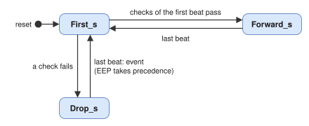

# spp_encapsulation: Architecture

## 1. Block diagram

## 2. Encapsulation (EN-1)

A combinational process selects the destination of the index in `TUser` of the presented beat and builds the header:
the first `Len` bytes of its Target SpaceWire Address followed by the Target Logical Address, 0x02, 0x00 and the User
Application value. `spp_header_insert` (maximum header `SpwAddrBytes_g` + 4 bytes) samples header and length with
the first beat of the packet and keeps one beat per clock cycle. The EEP flag of the output is masked to the last
beat.

## 3. Decapsulation (EN-2)

`spp_header_remove` removes `Cfg_RxStrip` + 4 bytes and outputs the removed bytes with every beat; `TUser` of the
removal carries the strip count of the packet, so that the CPTP fields are read at the right offset even if the
configuration changes later. The state machine decides with the first beat:

| Order | Check | Reason |
| --- | --- | --- |
| 1 | No byte beyond the CPTP header (`Out_Empty` of the removal) | 0x14 |
| 2 | Protocol Identifier not 2 | 0x11 |
| 3 | Reserved field not zero | 0x12 |
| 4 | Filter enabled and Target Logical Address neither `Cfg_Tla` nor 0xFE | 0x13 |

A discarded packet is reported with its last beat; when it ends with an EEP, the reason is 0x10. The event carries no
APID (index 0, APID 0): the Space Packet of a discarded CPTP packet is not interpreted.

## 4. Ports

| Port | Width | Direction | Description |
| --- | --- | --- | --- |
| `S_Pkt_*`, `M_Link_*` | `DataWidth_g` | | Encapsulation: Space Packets in, CPTP packets out; `User` 5 bits (EEP, destination) |
| `Cfg_DestAddr` | `NumDest_g` x 8 x max(`SpwAddrBytes_g`, 1) | in | Target SpaceWire Addresses, destination d in the bits of index d, byte 0 first |
| `Cfg_DestAddrLen` | `NumDest_g` x 5 | in | Address lengths |
| `Cfg_DestTla`, `Cfg_DestUa` | `NumDest_g` x 8 | in | Target Logical Addresses and User Application values |
| `S_Link_*`, `M_Pkt_*` | `DataWidth_g` | | Decapsulation: CPTP packets in (`User` 1 bit, EEP), Space Packets out (`User` 9 bits: EEP, User Application value) |
| `Cfg_RxStrip`, `Cfg_TlaCheck`, `Cfg_Tla` | 4, 1, 8 | in | Leading bytes removed, Target Logical Address filter |
| `Err` | event | out | Discarded packet |
