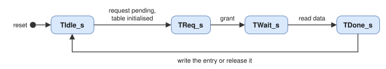

# spp_mib: Architecture

## 1. Block diagram

## 2. Register access

Writes are decoded in the cycle of `Rb_Wr`; a clear of a counter is applied before the events of the same cycle, so
no event is lost. Reads latch the address with `Rb_Rd` and answer one cycle later, except a read of a table entry
register while an access of its table is pending or the table initialises: the read stays pending until the access is
complete. The read timeout of the AXI4-Lite slave (4096 cycles) covers the initialisation of a table (2048 cycles).

## 3. Table access

One state machine per table, client B of the table:

A write of the APID register sets a read request, a write of the entry register a write request with its data; the
transaction always reads the entry first (the table protocol), then writes the new data or releases the entry. The
entry register shows the data written or the entry read with its double error flag. A write to the APID or entry
register while a request is pending or running is ignored and sets the overrun flag.

## 4. Counters and events

The error counters are indexed by the error code. Every cycle, the events of all sources are compared with each code
and the number of matching events is added with saturation. The source of the lowest index with an event is stored as
the last error and output on `Err_*` one cycle later. The packet counters add the number of `Rx_Delivered` bits set.
The event flags are set by the events and by `Evt_Sec` and `Evt_Ded` of the EDAC monitor; the interrupt is registered.

## 5. EDAC monitor and injection

`olo_ft_ecc_monitor` counts the SEC and DED pulses of 8 channels: 0 send data buffers, 1 send descriptor buffers,
2 send APID table, 3 its scrubber, 4 receive data buffer, 5 receive descriptor buffer, 6 receive APID table, 7 its
scrubber. A write of ECC_INJECT with SINGLE or DOUBLE produces a one-cycle injection command with the channel and the
end (RX bit); the sending and receiving ends apply it to the next write of the selected buffer or table.

## 6. Ports

| Port | Width | Direction | Description |
| --- | --- | --- | --- |
| `Clk`, `Rst` | 1 | in | Clock, synchronous high-active reset |
| `S_AxiLite_*` | 11-bit address, 32-bit data | | AXI4-Lite slave |
| `Irq` | 1 | out | Interrupt |
| `Cfg_*` | | out | Managed parameters and destinations (see `spp_encapsulation`, `spp_send`, `spp_receive`) |
| `TxTbl_*`, `RxTbl_*` | | | Client B of the send and the receive APID table; `*_Busy` inputs during their initialisation |
| `Err` | `NumErr_g` events | in | Error events of all sources |
| `Tx_Sent`, `Rx_Delivered`, `Rx_Loss` | 1, `NumRx_g`, 1 | in | Packet events |
| `Err_Valid`, `Err_Code`, `Err_Port`, `Err_Apid` | 1, 5, 4, 11 | out | Error event output |
| `Ecc_Sec`, `Ecc_Ded` | 8 | in | ECC events of the 8 channels |
| `Inj_TxValid`, `Inj_RxValid`, `Inj_Channel`, `Inj_Double` | 1, 1, 6, 1 | out | Injection commands |

The [register map](register_map.md) lists every register and field.
